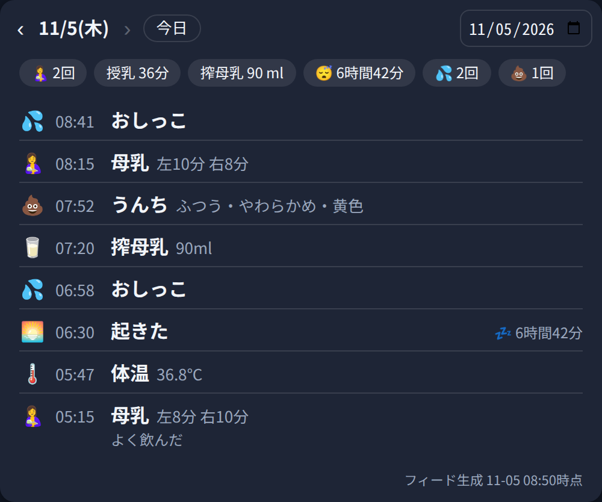
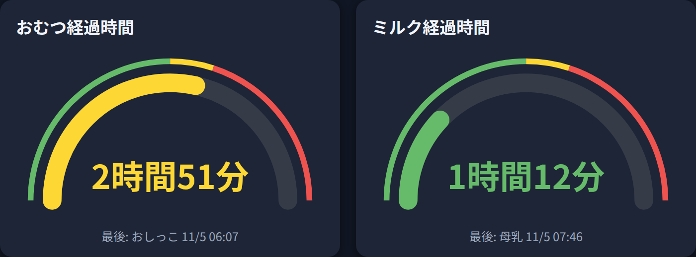

# PiyoLog for Home Assistant

育児記録アプリ「ぴよログ」の公式 **データフィード** を Home Assistant に取り込むカスタム統合です。
フィードURLを設定すると、ぴよログに記録した授乳・睡眠・排泄・身体計測などが、エンティティ、長期統計、同梱の Lovelace カードで利用できるようになります。

> [!IMPORTANT]
> **この統合は非公式のサードパーティ製です。** ぴよログ公式（Sakabou Inc.／株式会社サカボウ）とは一切関係ありません。公式に提供されている「データフィード」機能の URL を、利用者自身が設定して読み取る仕組みです。ぴよログおよび PiyoLog の名称・ロゴの権利は、権利者である Sakabou Inc. に帰属します。

この統合は **読み取り専用** です。Home Assistant からぴよログへ記録を追加・変更・削除することはできません。

A Home Assistant custom integration for the official **PiyoLog data feed** (schema v1, read-only).
It exposes feed records as entities, imports past records into long-term statistics, and bundles a Lovelace timeline card. The detailed feed-field and entity mapping tables in this README are written in Japanese; entity IDs and feed type names are language-neutral.

- バージョン: 1.7.7
- ドメイン: `piyolog`
- 方式: `cloud_polling`（Home Assistant からフィードを定期取得）
- 追加の Python 依存: なし

## この統合でできること

お子様1人分のフィードにつき、1つの設定エントリと1つのデバイスを作成します。標準では **44個の sensor と1個の binary_sensor、合計45エンティティ** を提供します。

| 分類 | 個数 | 内容 |
|---|---:|---|
| 最終記録センサー | 25 | 記録の種類ごとに、フィード範囲内で最後に記録された日時と値 |
| 身体計測センサー | 6 | 体重・身長・体温・頭囲・胸囲・足サイズの最新値 |
| 当日集計センサー | 10 | 今日の授乳・ミルク・睡眠・排泄などの合計と回数 |
| タイムライン／フィード状態 | 3 | 当日の記録、直近100件、フィード生成時刻 |
| 睡眠状態 | 1 | `Sleep` と `WakeUp` のペアから判定した現在の睡眠状態 |

また、次も自動で行います。

- フィードの過去記録を Home Assistant の長期統計へインポートする（常時有効）
- 同梱カード `custom:piyolog-card` と WebSocket API `piyolog/get_records` で、指定した1日分の記録をフィードの時刻・値で表示する
- 同梱カード `custom:piyolog-elapsed-card` で、最後のおむつ交換・授乳からの経過時間を、しきい値で色が変わるゲージで表示する
- メインフィードと長期間フィードの2本が設定された場合は、`event_id` 単位でマージしてから集計する
- フィードが繰り返し404を返す場合は、失効・期限切れの可能性として修復通知を表示する

フィードにはお子様の名前やIDは含まれません。画面上のデバイス名には、設定時に利用者が入力したラベルを使います。

## 必要なもの

- ぴよログアプリ v9.4.0以降で作成したデータフィードURL
  - アプリの「設定 → データフィード」から、対象のお子様・取得期間・有効期限を選んで作成します
  - フィードURL自体が認証情報です。パスワードと同じように扱ってください
- Home Assistant のタイムゾーン設定
  - 「今日」の区切り、日別集計、カードの日付判定には Home Assistant の既定タイムゾーンを使います

フィードは1本だけでも動作します。2本使う場合は、役割を分けると分かりやすくなります。

| フィード | 想定 | 役割 |
|---|---|---|
| メインフィード | 24時間など | 授乳・睡眠・排泄など、当日データの鮮度を担当 |
| 長期間フィード（任意） | 28日など | 体重・身長など毎日は記録されない項目の最新値と、日次統計の範囲を担当 |

28日フィードをメインフィードとして1本だけ使うこともできます。その場合は鮮度がフィード側のキャッシュ時間に影響されます。

公式フィードのキャッシュ保持時間は、期間ごとに次のとおりです。取得間隔を短くしても、この時間より速く新しいJSONが返るとは限りません。

| フィード期間 | キャッシュ保持時間 |
|---|---:|
| 24時間 | 1分 |
| 3日 | 2分 |
| 7日 | 5分 |
| 28日 | 15分 |

## インストール

### HACS（カスタムリポジトリ）

1. HACS → ⋯ → カスタムリポジトリに `https://github.com/grfkrn/homeassistant-integration-piyolog` を「統合」として追加します
2. 「PiyoLog」をインストールし、Home Assistant を再起動します
3. 「設定 → デバイスとサービス → 統合を追加」から「PiyoLog」を選びます
4. 下の「設定項目とフィードURLの対応表」に従って入力します

### 手動

`custom_components/piyolog` フォルダを Home Assistant の `config/custom_components/` にコピーして再起動し、上記3以降を行ってください。

## 設定項目とフィードURLの対応表

設定は config flow のみで、YAML は不要です。

| 設定項目 | 必須 | 入れる値・動作 |
|---|---|---|
| ラベル（デバイス名） | 任意 | Home Assistant 上のデバイス名と設定エントリ名。空欄の場合は `PiyoLog`。entity_id には影響しません |
| フィードURL | 必須 | メインフィードのURL。形式は `https://feed.piyolog.com/v1/feed/{期間}/{フィードID}/{秘密部分}` で、期間は `24h` / `3d` / `7d` / `28d` のいずれかです |
| 長期間フィードURL | 任意 | 28日フィードなど、もう1本のフィードURL。メインフィードと同じ形式です |

設定時は、形式チェックだけでなく、入力されたフィードを実際に1回取得して確認します。

- URL形式が違う場合は `invalid_url` として入力画面に戻ります
- 404の場合は、期限切れ・失効・プラン停止などを示す `feed_unavailable` になります
- その他のHTTPエラー、通信エラー、JSON形式エラーは `cannot_connect` になります
- メインフィードのフィードIDを unique ID として使うため、同じメインフィードを重複登録できません

統合の「設定」からは、メインフィードの取得間隔を変更できます。

| オプション | 既定値 | 範囲・備考 |
|---|---:|---|
| メインフィードの取得間隔 | 5分 | 1〜60分。長期間フィードは、設定にかかわらず最大15分に1回だけ取得します |

### フィードURLの保存場所と取り扱い

入力したURLは Home Assistant の設定エントリとして、Home Assistant 内の `.storage/core.config_entries` に保存されます。そのため、Home Assistant のバックアップ一式にはフィードURLも含まれます。

- 診断（diagnostics）では、メインフィードと長期間フィードのURLはマスクされます
- 統合がぴよログ以外の外部サービスへ育児記録を送信することはありません
- データの流れは「ぴよログのフィード → 利用者の Home Assistant」です

## データフィードの形式

公式データフィードは、集計済みデータではなく、記録そのものの一覧を JSON で返します。集計はこの統合側で行います。

次は説明用の架空サンプルです。実在のフィードURLや記録ではありません。

```json
{
  "schema_version": 1,
  "generated_at": "2026-01-01T12:00:00.000Z",
  "range": {
    "from": "2025-12-31T12:00:00.000Z",
    "to": "2026-01-01T12:00:00.000Z"
  },
  "records": [
    {
      "event_id": "example-breast-feeding-1",
      "datetime": "2026-01-01T01:00:00.000Z",
      "type": "BreastFeeding",
      "leftTime": 300,
      "rightTime": 240,
      "last": "right",
      "value": {"value": 80, "unit": "ml"}
    },
    {
      "event_id": "example-poop-1",
      "datetime": "2026-01-01T02:00:00.000Z",
      "type": "Poop",
      "details": {
        "amount": "normal",
        "hardness": "soft",
        "color": "yellow"
      },
      "memo": "example"
    }
  ]
}
```

### トップレベルの項目

| JSON項目 | 概要 | 統合での扱い |
|---|---|---|
| `schema_version` | フィード仕様の版 | 現在は `1` のみ対応。異なる値は形式エラーとして扱い、記録0件とは解釈しません |
| `generated_at` | このJSONが生成された時刻（ISO 8601、通常はUTC） | `sensor.piyolog_last_update` の状態。2本のフィードでは、より新しい方の生成時刻を使います |
| `range.from` / `range.to` | フィードが対象とする期間 | 参考情報として返されますが、集計範囲の判定には直接使いません。実際に返った `records` をもとに集計します |
| `records` | 記録の配列 | 時刻順に並べ替え、`event_id` で重複を取り除いてから集計します |

### 各記録の共通項目

| JSON項目 | 概要 | 統合での扱い |
|---|---|---|
| `event_id` | 記録を一意に識別するID | 2本のフィードをマージする際の重複判定キー。エンティティやカードの応答には含めません |
| `datetime` | 記録された日時。ISO 8601で、通常はUTC | Home Assistant の既定タイムゾーンへ変換して、日付判定と表示を行います |
| `type` | 記録の種類。下記「フィード項目（type）一覧」を参照 | 対応する最終記録・身体計測・当日集計へ振り分けます |
| `value` | 量や測定値を表すオブジェクト（任意） | `value.value` が数値なら量・測定値として取り出します。未入力で省略された場合は **0として扱いません** |
| `value.value` | 数値の本体 | ミルク量、母乳量、体重、体温など。種類ごとに意味と単位が変わります |
| `value.unit` | フィードが示す単位文字列 | 最終記録センサーでは属性 `unit` にそのまま保持します。身体計測センサーでは、各センサーで定義した kg / cm / °C として扱います |
| `memo` | 自由記述のメモ（任意） | 最終記録センサーの属性 `memo`、タイムライン項目の `memo` に反映します |
| その他の項目 | 種類固有の項目 | 授乳の `leftTime` / `rightTime` / `last`、うんちの `details` など、下記の専用項目を使います |

トップレベルの形式が不正な場合は取得全体を失敗として扱います。一方、個別の記録で `event_id`、`type`、有効なタイムゾーン付き `datetime` のいずれかが欠けている場合は、その記録だけを読み飛ばします。

### 2本のフィードのマージ規則

- 同じ `event_id` が両方に現れた場合は重複として1件にします
- 同じ `event_id` の内容が異なる場合は、`generated_at` が新しいスナップショット側の記録を採用します。これにより、アプリ側の編集が反映されます
- 毎回、取得できたスナップショット全体から集計し直します。そのため、両方のフィードから記録が消えれば、集計からも外れます
- 長期間フィードの取得に失敗した場合は、前回成功時のスナップショットがあればそれを使い続けます。初回から取得できない場合は、メインフィードだけで集計します

### 値が省略された記録の扱い

ぴよログでは、未入力の値はJSONから省略されます。この統合では「記録があったこと」と「量が入力されていたこと」を分けて扱います。

- 回数は、値が省略された記録も含めて数えます
- 量の合計には、数値が入っている記録だけを加えます
- 母乳量では、量が記録された回数を `measured_count` として分けて持ちます
- 値が省略された記録を、量0の記録として統計へ入れることはありません

### 授乳（`BreastFeeding`）の専用項目

| JSON項目 | 単位・値 | 対応先 |
|---|---|---|
| `leftTime` | 左側の授乳時間（秒） | 最終記録の属性 `left_minutes`（分へ換算し四捨五入）、当日授乳時間、タイムライン要約、日次統計 |
| `rightTime` | 右側の授乳時間（秒） | 最終記録の属性 `right_minutes`（分へ換算し四捨五入）、当日授乳時間、タイムライン要約、日次統計 |
| `last` | 最後に授乳した側を示す文字列（`left` / `right`） | 最終記録の属性 `last_side` にそのまま保持 |
| `value.value` | 測定された母乳量（ml、任意） | 最終記録の属性 `value`、今日の母乳量、日次統計。未記録の回は合計に入れません |

当日の授乳時間は、その日に属する各記録の `leftTime + rightTime` を秒で合計し、最後に分へ換算します。左右どちらかだけが記録されている場合は、記録されている側だけを合計します。

### うんち（`Poop`）の `details`

`details` の値はコード文字列で返ります。最終記録センサーの属性にはコードをそのまま入れ、タイムラインの要約では次の日本語へ変換します。

| 項目 | JSONの値 | タイムライン表示 |
|---|---|---|
| `amount`（量） | `minimum` | ちょっと |
|  | `small` | 少なめ |
|  | `normal` | ふつう |
|  | `large` | 多め |
| `hardness`（かたさ） | `diarrhea` | 下痢 |
|  | `soft` | やわらかめ |
|  | `normal` | ふつう |
|  | `hard` | かため |
| `color`（色） | `white` | 白 |
|  | `yellow` | 黄 |
|  | `orange` | 橙 |
|  | `brown` | 茶 |
|  | `green` | 緑 |
|  | `red` | 赤 |
|  | `black` | 黒 |

各項目は任意です。入っている項目だけを属性と要約に反映します。

### 睡眠（`Sleep` / `WakeUp`）の扱い

フィードには睡眠時間そのものは含まれず、「寝る」と「起きる」が独立した記録として返ります。この統合では時刻順にペアを作ります。

- `Sleep` が睡眠の開始です
- 次に現れる `WakeUp` がその睡眠の終了です
- `Sleep` が連続した場合は、後ろの（新しい）`Sleep` を開始時刻として使います
- 最後の `Sleep` に対応する `WakeUp` がまだ無い場合は、現在睡眠中として扱います
- 日をまたぐ睡眠は、ローカル日付ごとに分割して日次集計へ入れます
- 今日の睡眠時間には、今日と重なる区間だけを入れます。進行中の睡眠は、集計時点の現在時刻までを入れます
- フィード範囲の開始前から寝ていて `Sleep` が範囲内に無い場合、その開始時刻は分からないため、範囲内の `WakeUp` だけでは睡眠時間を計算しません
- カード表示では、対応する `Sleep` が前日にある場合でも、その睡眠時間を当日の `WakeUp` 項目に表示できます

## フィード項目（`type`）一覧

日本語ラベルは、タイムラインやカードで使う表示名です。「主な対応先」にあるエンティティの詳細は、後述の対応表を参照してください。

| `type` | 日本語ラベル／項目概要 | 主な値・専用項目 | 主な対応先 |
|---|---|---|---|
| `BreastFeeding` | 母乳（直接授乳） | `leftTime`、`rightTime`、`last`、任意の `value.value`（ml） | 最終記録、授乳回数・時間・母乳量、長期統計 |
| `Formula` | ミルク | `value.value`（ml） | 最終記録、今日のミルク量、長期統計 |
| `ExpressedBreastMilk` | 搾母乳 | `value.value`（ml） | 最終記録、今日の搾母乳量、長期統計 |
| `Pumping` | 搾乳 | `value.value`（ml） | 最終記録、今日の搾乳量、長期統計 |
| `Sleep` | 寝る | 開始時刻は `datetime` | 最終記録、睡眠中センサー、睡眠時間 |
| `WakeUp` | 起きる | 終了時刻は `datetime` | 最終記録、睡眠中センサー、睡眠時間、カードの睡眠時間 |
| `Pee` | おしっこ | 発生時刻は `datetime` | 最終記録、今日のおしっこ回数、長期統計 |
| `Poop` | うんち | `details.amount` / `hardness` / `color` | 最終記録、今日のうんち回数、長期統計 |
| `Temperature` | 体温 | `value.value`（°C） | 身体計測、履歴属性、長期統計 |
| `Height` | 身長 | `value.value`（cm） | 身体計測、履歴属性、長期統計 |
| `Weight` | 体重 | `value.value`（kg） | 身体計測、履歴属性、長期統計 |
| `Head` | 頭囲 | `value.value`（cm） | 身体計測、履歴属性、長期統計 |
| `Chest` | 胸囲 | `value.value`（cm） | 身体計測、履歴属性、長期統計 |
| `Foot` | 足サイズ | `value.left`、`value.right`（cm） | 足サイズセンサー |
| `Solid` | 離乳食 | 時刻と `memo` が中心 | 最終記録、タイムライン |
| `Snack` | おやつ | 時刻と `memo` が中心 | 最終記録、タイムライン |
| `Meal` | ごはん | 時刻と `memo` が中心 | 最終記録、タイムライン |
| `Drink` | のみもの | `value.value`（ml） | 最終記録、今日ののみもの量、長期統計 |
| `Cough` | せき | 時刻と `memo` が中心 | 最終記録、タイムライン |
| `Vomiting` | 吐く | 時刻と `memo` が中心 | 最終記録、タイムライン |
| `Rash` | 発疹 | 時刻と `memo` が中心 | 最終記録、タイムライン |
| `Injury` | けが | 時刻と `memo` が中心 | 最終記録、タイムライン |
| `Bath` | お風呂 | 時刻と `memo` が中心 | 最終記録、タイムライン |
| `Medicine` | くすり | 時刻と `memo` が中心 | 最終記録、タイムライン |
| `Hospital` | 病院 | 時刻と `memo` が中心 | 最終記録、タイムライン |
| `Walking` | さんぽ | 時刻と `memo` が中心 | 最終記録、タイムライン |
| `Vaccine` | 予防接種 | 時刻と `memo` が中心 | 最終記録、タイムライン |
| `Milestone` | できた | 時刻と `memo` が中心 | 最終記録、タイムライン |
| `Memo` | メモ | 本文は `memo` | 最終記録、タイムライン |
| `Other` | その他 | 時刻と `memo` が中心 | 最終記録、タイムライン |
| `Custom1` ～ `Custom10` | カスタム1～10 | フィードにはアプリ側の設定名が含まれません | `sensor.piyolog_last_custom` に集約、タイムライン |

どの種類の記録にも `memo` が付く場合があります。また、最終記録センサーは、対象記録に数値の `value.value` がある場合は種類を問わず属性 `value` として取り出します。

## エンティティ対応表

### 表の読み方

- 「状態」は Home Assistant のエンティティの値そのものです
- 「属性」は、エンティティの詳細画面やテンプレートから参照できる追加情報です
- 「最新」「最後」は、取得できたフィード範囲内での最新を意味します。フィードから外れた過去の記録までは遡れません
- 「今日」は、Home Assistant の既定タイムゾーンにおけるローカル日付の0時から24時までです
- 最終記録センサーと身体計測センサーは、対象記録がフィード範囲内に無い場合 `unknown` になります
- 当日集計センサーは、対象記録が無い場合も原則として `0` を返します

### 最終記録センサー（25個）

状態はすべて、対応する `type` の最新記録の `datetime` です。対象が複数あるカスタム記録を除き、各センサーには共通属性 `count_today`（今日の同種記録数）が付きます。

共通属性は次のとおりです。

| 属性 | 元になるフィード値 | 内容 |
|---|---|---|
| `count_today` | 同じ `type` の当日記録数 | 値が省略された記録も含めて数えます |
| `value` | `value.value` | 最新記録に数値が入っている場合だけ付きます |
| `unit` | `value.unit` | フィード側の単位文字列をそのまま保持します |
| `memo` | `memo` | 最新記録にメモがある場合だけ付きます |

| entity_id | 表示名 | `type` | 種類固有の対応 |
|---|---|---|---|
| `sensor.piyolog_last_breast_feeding` | 最後の授乳 | `BreastFeeding` | `leftTime`（秒）→ `left_minutes`、`rightTime`（秒）→ `right_minutes`、`last` → `last_side`。量がある場合は `value` / `unit` |
| `sensor.piyolog_last_formula` | 最後のミルク | `Formula` | 量がある場合は `value` / `unit` |
| `sensor.piyolog_last_expressed_breast_milk` | 最後の搾母乳 | `ExpressedBreastMilk` | 量がある場合は `value` / `unit` |
| `sensor.piyolog_last_pumping` | 最後の搾乳 | `Pumping` | 量がある場合は `value` / `unit` |
| `sensor.piyolog_last_sleep` | 最後に寝た | `Sleep` | 睡眠開始時刻。固有の数値属性はありません |
| `sensor.piyolog_last_wake_up` | 最後に起きた | `WakeUp` | 起床時刻。睡眠時間は状態には含めず、睡眠集計とカードで扱います |
| `sensor.piyolog_last_pee` | 最後のおしっこ | `Pee` | 発生時刻。固有の数値属性はありません |
| `sensor.piyolog_last_poop` | 最後のうんち | `Poop` | `details.amount` → `amount`、`details.hardness` → `hardness`、`details.color` → `color`（コード文字列のまま） |
| `sensor.piyolog_last_drink` | 最後ののみもの | `Drink` | 量がある場合は `value` / `unit` |
| `sensor.piyolog_last_solid` | 最後の離乳食 | `Solid` | 数値がある場合は `value` / `unit` |
| `sensor.piyolog_last_snack` | 最後のおやつ | `Snack` | 数値がある場合は `value` / `unit` |
| `sensor.piyolog_last_meal` | 最後のごはん | `Meal` | 数値がある場合は `value` / `unit` |
| `sensor.piyolog_last_bath` | 最後のお風呂 | `Bath` | 数値がある場合は `value` / `unit` |
| `sensor.piyolog_last_medicine` | 最後のくすり | `Medicine` | 数値がある場合は `value` / `unit` |
| `sensor.piyolog_last_hospital` | 最後の病院 | `Hospital` | 数値がある場合は `value` / `unit` |
| `sensor.piyolog_last_walking` | 最後のさんぽ | `Walking` | 数値がある場合は `value` / `unit` |
| `sensor.piyolog_last_vaccine` | 最後の予防接種 | `Vaccine` | 数値がある場合は `value` / `unit` |
| `sensor.piyolog_last_milestone` | 最後の「できた」 | `Milestone` | 数値がある場合は `value` / `unit` |
| `sensor.piyolog_last_cough` | 最後のせき | `Cough` | 数値がある場合は `value` / `unit` |
| `sensor.piyolog_last_vomiting` | 最後に吐いた | `Vomiting` | 数値がある場合は `value` / `unit` |
| `sensor.piyolog_last_rash` | 最後の発疹 | `Rash` | 数値がある場合は `value` / `unit` |
| `sensor.piyolog_last_injury` | 最後のけが | `Injury` | 数値がある場合は `value` / `unit` |
| `sensor.piyolog_last_memo` | 最後のメモ | `Memo` | メモ本文は属性 `memo` |
| `sensor.piyolog_last_other` | 最後のその他 | `Other` | 数値がある場合は `value` / `unit` |
| `sensor.piyolog_last_custom` | 最後のカスタム記録 | `Custom1` ～ `Custom10` | 10種類の中で最も新しい記録の日時。属性 `custom_type` に元の `type`、メモがある場合は `memo`。共通属性 `count_today` は付きません |

最終記録センサーの状態は「フィードに記録された時刻」です。Home Assistant がその変化を検出した時刻ではありません。複数件が1回の取得でまとめて入った場合、Home Assistant のログブック上の変更時刻は取得時刻側になりますが、センサーの状態値には各記録の `datetime` が入ります。

### 身体計測センサー（6個）

状態は、対応する `type` の最新記録の `value.value` です。足サイズ以外には、計測日時 `measured_at` と、フィード範囲内の全計測点を持つ `history` 属性が付きます。

`history` は古い順の配列で、各要素は `{"time": ローカル時刻のISO文字列, "value": 数値}` です。保持上限は新しい順に200点です。Home Assistant のレコーダーには統合導入前の状態履歴が無いため、導入前の推移をグラフ化したい場合に使えます。

| entity_id | 表示名 | `type` | 状態の単位 | 属性・備考 |
|---|---|---|---|---|
| `sensor.piyolog_weight` | 体重 | `Weight` | kg | `measured_at`、`history`。長期統計にも投入します |
| `sensor.piyolog_height` | 身長 | `Height` | cm | `measured_at`、`history`。長期統計にも投入します |
| `sensor.piyolog_temperature` | 体温 | `Temperature` | °C | `measured_at`、`history`。長期統計にも投入します |
| `sensor.piyolog_head_circumference` | 頭囲 | `Head` | cm | `measured_at`、`history`。長期統計にも投入します |
| `sensor.piyolog_chest_circumference` | 胸囲 | `Chest` | cm | `measured_at`、`history`。長期統計にも投入します |
| `sensor.piyolog_foot_size` | 足サイズ | `Foot` | cm | 状態は `value.left` を優先し、左が無い場合は `value.right`。属性 `measured_at` と、存在する側の `left` / `right`。`history` と長期統計の対象外です |

身体計測には、別途「最後の体重」などの timestamp センサーは作りません。最新の計測日時は各センサーの `measured_at` 属性で確認します。

### 当日集計センサー（10個）

| entity_id | 表示名 | 元になるフィード値 | 算出方法 | 単位・属性 |
|---|---|---|---|---|
| `sensor.piyolog_today_breast_feeding_count` | 今日の授乳回数 | 今日の `BreastFeeding` 件数 | 値の有無にかかわらず記録件数を数えます | 回 |
| `sensor.piyolog_today_breast_feeding_duration` | 今日の授乳時間 | `leftTime`、`rightTime` | 各記録の左右を秒で合計し、分へ換算して小数第1位まで表示 | 分 |
| `sensor.piyolog_today_breast_feeding_total` | 今日の母乳量 | `BreastFeeding.value.value` | 数値が入っている記録だけを合計します | ml。属性 `count_today` は全授乳回数、`measured_count` は量が記録された回数 |
| `sensor.piyolog_today_formula_total` | 今日のミルク量 | `Formula.value.value` | 数値が入っている記録だけを合計します | ml。属性 `count_today` は量の有無を含むミルク記録数 |
| `sensor.piyolog_today_expressed_breast_milk_total` | 今日の搾母乳量 | `ExpressedBreastMilk.value.value` | 数値が入っている記録だけを合計します | ml |
| `sensor.piyolog_today_pumping_total` | 今日の搾乳量 | `Pumping.value.value` | 数値が入っている記録だけを合計します | ml |
| `sensor.piyolog_today_drink_total` | 今日ののみもの量 | `Drink.value.value` | 数値が入っている記録だけを合計します | ml |
| `sensor.piyolog_today_pee_count` | 今日のおしっこ回数 | 今日の `Pee` 件数 | 記録件数を数えます | 回 |
| `sensor.piyolog_today_poop_count` | 今日のうんち回数 | 今日の `Poop` 件数 | 記録件数を数えます | 回 |
| `sensor.piyolog_today_sleep_total` | 今日の睡眠時間 | `Sleep` / `WakeUp` のペア | 睡眠区間と今日の重なりを合計し、分へ換算して小数第1位まで表示。進行中は現在時刻まで | 分 |

量センサーが `0 ml` の場合、「その種類の記録自体が無い」か「記録はあるが量が未入力」のどちらかです。母乳量は `measured_count`、ミルク量は `count_today` で区別できます。その他の量センサーでは、タイムラインや最終記録も合わせて確認してください。

### 状態・タイムライン・フィード状態（4個）

| entity_id | 表示名 | 状態 | 属性 |
|---|---|---|---|
| `binary_sensor.piyolog_sleeping` | 睡眠中 | 最後に未終了の `Sleep` があれば ON、それ以外は OFF | `sleeping_since`: ONの場合は睡眠開始時刻、OFFの場合は `null` |
| `sensor.piyolog_timeline` | タイムライン | 全種類を通じた最新記録の `datetime` | `records`: 今日の記録を新しい順に最大50件。`records_today`: 属性に保持している件数。`generated_at`: フィード生成時刻 |
| `sensor.piyolog_recent_events` | 直近の記録 | 全種類を通じた最新記録の `datetime` | `records`: 日付を問わず新しい順に最大100件。`count`: 属性に保持している件数。`total_records`: マージ後の全記録数。`generated_at`: フィード生成時刻 |
| `sensor.piyolog_last_update` | フィード最終更新 | フィードの `generated_at`。2本構成では新しい方 | `record_count`: マージ後の全記録数 |

`sensor.piyolog_timeline` の `records` は当日の分だけですが、状態そのものは全期間の最新記録です。そのため、今日まだ記録が無くても、状態には前日以前の最新記録日時が入り、`records` は空になることがあります。

#### タイムライン項目の形式

`records` の各要素は次の形式です。

| キー | 内容 |
|---|---|
| `time` | `datetime` を Home Assistant の既定タイムゾーンへ変換したISO文字列 |
| `type` | フィードの `type` をそのまま保持 |
| `label` | `type` に対応する日本語ラベル。カスタム記録は「カスタム1」など |
| `summary` | フィード値から生成した短い要約。要約を作らない種類では空文字列 |
| `memo` | メモがある場合だけ含めます |

`summary` の生成規則は次のとおりです。

| 対象 | `summary` の形式 |
|---|---|
| `BreastFeeding` | 記録されている項目だけを並べます。例: `左5分 右4分 80ml`。左右は秒から分へ換算し四捨五入 |
| `Formula` / `ExpressedBreastMilk` / `Pumping` / `Drink` | `120ml`。量が無い場合は空文字列 |
| `Poop` | 量・かたさ・色を日本語化し、`・` で連結。例: `ふつう・やわらかめ・黄` |
| `Temperature` | `36.7℃` |
| `Weight` | `6.3kg` |
| `Height` / `Head` / `Chest` | `60cm` |
| `Foot` | 記録されている側だけを並べます。例: `左9cm 右9.2cm` |
| その他の種類 | 空文字列。時刻、`label`、`memo` で内容を表します |

## 長期統計への自動インポート

この統合は、フィードの過去記録を Home Assistant の **長期統計** へ自動で投入します。設定は不要で、常時有効です（無効化する設定はありません）。

状態履歴は過去へさかのぼって追加できないため、導入前の記録は長期統計で扱います。投入内容が変わった場合だけ再送し、同じ内容を繰り返し送ることはありません。統計インポートでエラーが起きても、その系列だけを失敗として記録し、通常のエンティティ更新は継続します。

レコーダーが有効でない環境では投入されません。

### 身体計測の統計

体重・身長・体温・頭囲・胸囲は、各センサー自身の統計として投入します。足サイズは対象外です。

| フィード `type` | 統計ID | 単位 | 投入方法 |
|---|---|---|---|
| `Weight` | `sensor.piyolog_weight` | kg | 過去日分を1時間ごとにまとめ、各時間の平均・最小・最大を投入 |
| `Height` | `sensor.piyolog_height` | cm | 同上 |
| `Temperature` | `sensor.piyolog_temperature` | °C | 同上 |
| `Head` | `sensor.piyolog_head_circumference` | cm | 同上 |
| `Chest` | `sensor.piyolog_chest_circumference` | cm | 同上 |

当日分は対象外です。当日分は Home Assistant のレコーダーが、稼働中のセンサー状態から通常どおり生成します。

### 日次合計の外部統計

日次合計は、外部統計 `piyolog:daily_*` として投入します。各日について、値が計算できた系列だけを作成し、値のない日を0で埋めることはありません。当日分も含み、フィード更新のたびにその時点までの値へ更新されます。

| 統計ID | 元になる記録・項目 | 内容 | 単位 |
|---|---|---|---|
| `piyolog:daily_breast_feeding_ml` | `BreastFeeding.value.value` | 量が記録された母乳の1日合計 | ml |
| `piyolog:daily_breast_feeding_count` | `BreastFeeding` | 1日の授乳回数 | なし（回数） |
| `piyolog:daily_breast_feeding_minutes` | `leftTime` + `rightTime` | 1日の授乳時間 | 分 |
| `piyolog:daily_formula_ml` | `Formula.value.value` | 1日のミルク量 | ml |
| `piyolog:daily_expressed_breast_milk_ml` | `ExpressedBreastMilk.value.value` | 1日の搾母乳量 | ml |
| `piyolog:daily_pumping_ml` | `Pumping.value.value` | 1日の搾乳量 | ml |
| `piyolog:daily_drink_ml` | `Drink.value.value` | 1日ののみもの量 | ml |
| `piyolog:daily_pee_count` | `Pee` | 1日のおしっこ回数 | なし（回数） |
| `piyolog:daily_poop_count` | `Poop` | 1日のうんち回数 | なし（回数） |
| `piyolog:daily_sleep_minutes` | `Sleep` / `WakeUp` | 1日に属する睡眠時間。日をまたぐ場合は各日へ分割 | 分 |

### 統計利用時の注意

- 投入された統計は長期統計として保持され、**統合を削除しても Home Assistant 側に残ります**
- 不要になった統計は、「開発者ツール → 統計」から該当する統計を選んで削除してください
- フィードから取得できるのは最大で直近28日分です。それより前の期間については、統合が稼働中に投入した統計だけが残ります
- 長期統計はエンティティの状態履歴とは別物です。過去日の一覧を時刻・値そのままで見る用途には、同梱カードを使ってください

## 同梱の Lovelace カード

統合には専用カード `custom:piyolog-card` が同梱されています。セットアップ時に自動で登録されるため、Lovelace リソースの手動追加は不要です。ダッシュボードのカード選択画面では「PiyoLog Timeline」として表示され、プレビューには当日の実データがそのまま表示されます。

カードJSの登録は2経路で行われます。`add_extra_js_url`（フロントの土台ページへの埋め込み）と、Lovelace リソースへの自動登録（ストレージモード時のみ。HACS カードと同じ読み込み経路）です。2経路のURLはクエリ文字列を意図的に分けてあります（土台側は `?e=<版数>`、リソース側は `?v=<版数>`）。ブラウザはモジュールの読み込み結果をURL単位で保持するため、同一URLだと片方の取得失敗がもう片方にも及んで「Custom element doesn't exist」のままになることがあり、分離することで片方が失敗してももう片方から読み込めます。リソース一覧には `/piyolog_static/…?v=<版数>` の2件が自動で追加・更新されます（YAML モードでは追加されません）。

各カードの詳細とトラブルシューティングは [同梱カードの詳細](docs/cards.md) にまとめています。



```yaml
type: custom:piyolog-card
entity: sensor.piyolog_timeline
```

任意でタイトルも指定できます。

```yaml
type: custom:piyolog-card
title: ぴよログ
entity: sensor.piyolog_timeline
```

カードの動作は次のとおりです。

- 選択した1日分の記録を、フィードの時刻と値をもとに新しい順で表示します
- 前日・翌日ボタン、日付ピッカー、「今日」ボタンで日付を移動できます。未来の日付へは移動できません
- その日のサマリーがある場合は、授乳回数・母乳量・授乳時間・ミルク量・搾母乳量・搾乳量・のみもの量・睡眠時間・おしっこ回数・うんち回数をチップ表示します
- `WakeUp` に対応する `Sleep` が見つかった場合は、睡眠時間も表示します。前日に寝た場合も対象です
- 対象センサーの状態が変わると再取得します
- 遡れる範囲は、取得済みフィードの範囲までです（最大28日）

### 経過時間ゲージカード `custom:piyolog-elapsed-card`

最後の記録からどれだけ時間が経ったかを、半円ゲージで表示するカードも同梱されています。タイムラインカードと同じく自動登録され、ビジュアルエディタにも対応しています。ゲージは30秒ごとに再計算されるため、記録が無くても経過時間が進みます。



```yaml
# おむつ経過時間（うんち／おしっこのうち新しい方から計測）
type: custom:piyolog-elapsed-card
mode: diaper
entity: sensor.piyolog_timeline
```

```yaml
# ミルク経過時間（搾母乳／母乳／ミルクのうち新しい方から計測）
type: custom:piyolog-elapsed-card
mode: feeding
entity: sensor.piyolog_timeline
```

| 設定 | 意味 | 既定値（diaper） | 既定値（feeding） |
|---|---|---:|---:|
| `mode` | `diaper`（うんち／おしっこ）または `feeding`（搾母乳／母乳／ミルク） | `diaper` | — |
| `entity` | 対象のお子様を特定するアンカー。ここから同じ接頭辞の最終記録センサーを参照します | `sensor.piyolog_timeline` | 同左 |
| `title` | カードのタイトル | おむつ経過時間 | ミルク経過時間 |
| `yellow_after_hours` | 緑→黄の切替わり（時間） | 2.5 | 2.5 |
| `red_after_hours` | 黄→赤の切替わり（時間） | 3 | 3 |
| `max_hours` | ゲージの最大値（時間）。経過時間がこれを超えても数値は増え続け、ゲージだけが最大で止まります | 5 | 5 |
| `entities` | （任意）参照する最終記録センサーを直接並べる場合に使います。通常は不要です | — | — |

計測対象は次の最終記録センサーです。グループ内で最も新しい記録の `datetime` から現在時刻までの経過を「1時間45分」形式で表示し、最後に使われた記録の種類と時刻も小さく表示します。

- diaper: `sensor.piyolog_last_poop`（うんち）、`sensor.piyolog_last_pee`（おしっこ）
- feeding: `sensor.piyolog_last_expressed_breast_milk`（搾母乳）、`sensor.piyolog_last_breast_feeding`（母乳）、`sensor.piyolog_last_formula`（ミルク）。搾乳（Pumping）は授乳ではないため対象に含めません

しきい値は「黄色 ＜ 赤 ＜ 最大」の順になっている必要があります。順序が不正な場合は、カードに設定確認のメッセージが表示されます。対象の記録が1件も無い場合は「記録がありません」と表示されます。

### WebSocket API `piyolog/get_records`

カードは、センサー属性ではなく WebSocket API から日別の記録を取得します。これにより、28日分すべてをセンサー属性へ載せる必要がありません。

リクエスト:

```json
{
  "type": "piyolog/get_records",
  "entity_id": "sensor.piyolog_timeline",
  "date": "2026-01-01"
}
```

| リクエスト項目 | 内容 |
|---|---|
| `entity_id` | 対象の PiyoLog 設定エントリに属するエンティティ。カードでは `sensor.piyolog_timeline` の使用を想定しています |
| `date` | ローカル日付（`YYYY-MM-DD`） |

応答:

| 応答項目 | 内容 |
|---|---|
| `date` | 要求された日付 |
| `entries` | その日のタイムライン項目。新しい順、最大300件。基本形式は前述のタイムライン項目と同じです |
| `entries[].duration_minutes` | `WakeUp` に対応する `Sleep` がある場合だけ追加される睡眠時間（分） |
| `summary` | その日の日次合計。キーは `breast_feeding_ml`、`sleep_minutes` など長期統計の日次系列と同じ名前で、値がある項目だけを含みます |
| `generated_at` | 応答に使ったフィードの生成時刻 |

エラーコードは `entity_not_found`（エンティティが無い）、`not_piyolog`（PiyoLog の設定エントリに属していない）、`invalid_date`（日付形式が違う）です。

このAPIは Home Assistant の認証済み WebSocket 接続でのみ利用します。応答にフィードURLと `event_id` は含めません。

## 動作・エラー時の扱い

### 取得の失敗

- メインフィードの取得に失敗すると、その回の更新は失敗として扱います
- 長期間フィードだけが失敗した場合は、前回のスナップショットがあればそれを使い、無ければメインフィードだけで続けます
- メインフィードが404を3回連続で返すと、修復通知を作成します。次に成功すると通知は消えます
- 404以外のエラーでは、404の連続回数をリセットします

### 既知の制約

- ぴよログへの書き込みはできません
- フィードの取得範囲は最大28日です。28日より前の記録そのものは、フィードから再取得できません
- 短期間フィードだけでは、体重などの古い最新値が範囲外になることがあります。身体計測を安定して表示したい場合は長期間フィードを追加してください
- カスタム記録の設定名はフィードに含まれないため、Home Assistant では `Custom1` ～ `Custom10`、または「カスタム1」～「カスタム10」と表示します
- `sensor.piyolog_timeline` の属性は最大50件、`sensor.piyolog_recent_events` の属性は最大100件、身体計測の `history` 属性は最大200点です。特定の1日分をまとめて見る場合はカードを使ってください
- お子様が複数いる場合は、お子様ごとにフィードと設定エントリを分けてください。2件目以降で entity_id が重なる場合は、Home Assistant の規則に従って連番が付くことがあります

## ファイル構成

```text
custom_components/piyolog/
  manifest.json        統合メタデータ（ドメイン、版数、依存関係）
  const.py             ドメイン、設定キー、フィードの type と日本語ラベル、うんちのコード表
  config_flow.py       設定画面とオプション画面、フィードURLの形式・接続確認
  coordinator.py       定期取得、2本のフィードのマージ、統計インポートの呼び出し
  feed.py              HA非依存のフィード解析・集計・タイムライン生成
  sensor.py            最終記録、身体計測、当日集計、タイムライン等の44センサー
  binary_sensor.py     睡眠中 binary_sensor
  statistics.py        身体計測と日次合計の長期統計インポート
  websocket_api.py     piyolog/get_records（カード向け日別取得API）
  frontend.py          同梱カード用JSの配信、extra JS URL 登録、Lovelace リソース自動登録
  frontend/
    piyolog-timeline-card.js PiyoLog Timeline カード
    piyolog-elapsed-card.js  経過時間ゲージカード（エディタ付き）
  diagnostics.py       診断情報（フィードURLはマスク）
  brand/               ぴよログのロゴ
  strings.json         設定画面の文言（英語）
  translations/        設定画面とエンティティ名（ja / en）
tests/
  test_feed.py         フィード解析・集計のテスト
  test_config_flow.py  設定画面のテスト
  test_init.py         統合セットアップのテスト
  test_websocket.py    WebSocket API のテスト
  test_frontend.py     同梱カードの同梱・登録チェック
docs/
  cards.md             同梱カードの詳細とトラブルシューティング
  images/              カードのサンプル画像（実際のカードコード＋架空データで描画）
```

## テスト

```bash
python -m pip install -r requirements_test.txt
python -m pytest tests/
```

Home Assistant 2026.2.3 / pytest-homeassistant-custom-component 0.13.316 の開発環境で、33件全件の合格を確認しています。テストデータはすべて架空のフィクスチャで、実フィードや実記録は含みません。

## 注意事項

- この統合は、ぴよログ公式のデータフィード仕様（schema v1）に基づく、非公式のサードパーティ製です
- ぴよログおよび PiyoLog の名称・ロゴは、権利者である Sakabou Inc.（株式会社サカボウ）に帰属します
- フィード仕様が変更された場合は、`schema_version` や項目の変更に追随できないことがあります

## ライセンス

MIT License. Copyright (c) 2026 grfkrn.
