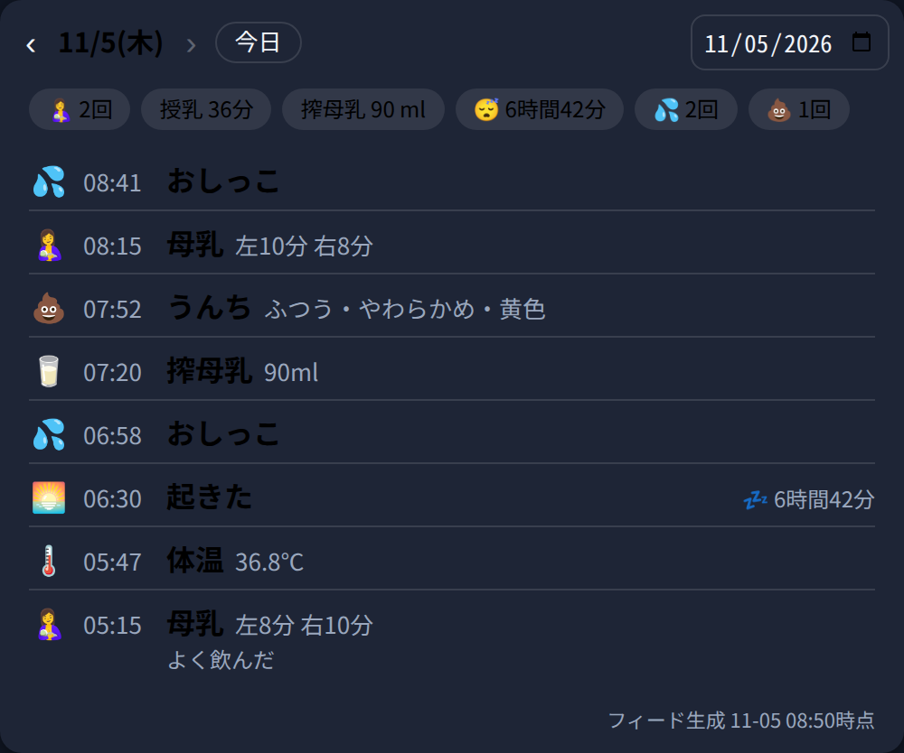
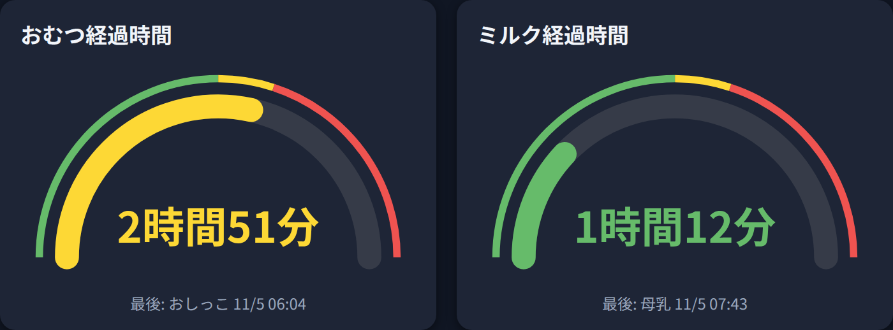

# 同梱カードの詳細

この統合には、専用の Lovelace カードが2種類同梱されています。統合をセットアップすると自動で登録されるため、Lovelace リソースの手動追加は不要です。ダッシュボードのカード選択画面（カードピッカー）にも表示され、プレビューには実データがそのまま出ます。

このページのサンプル画像は、実際のカードコードにサンプルデータを与えて描画したものです（収録されている記録はすべて架空のものです）。

## タイムラインカード `custom:piyolog-card`



1日分の記録を、フィードの時刻・値そのままで表示するカードです。センサーの属性では運びきれない件数の記録を扱うため、表示データは統合の WebSocket API（`piyolog/get_records`）から都度取得します。追加の外部通信は発生しません。

### できること

- 選択した1日分の記録を、フィードの時刻と値をもとに新しい順で表示
- 前日・翌日ボタン、日付ピッカー、「今日」ボタンで日付を移動（未来の日付へは移動不可）
- その日のサマリーをチップ表示（授乳回数・母乳量・授乳時間・ミルク量・搾母乳量・搾乳量・のみもの量・睡眠時間・おしっこ回数・うんち回数）
- `WakeUp` に対応する `Sleep` が見つかった場合は睡眠時間も表示（前日に寝た場合も対象）
- 対象センサーの状態が変わると自動で再取得
- 遡れる範囲は取得済みフィードの範囲まで（最大28日）

### 設定

| 設定 | 意味 | 既定値 |
|---|---|---|
| `entity` | 対象のお子様を特定するアンカー。通常はタイムラインセンサー | `sensor.piyolog_timeline` |
| `title` | 任意のタイトル | （なし） |

```yaml
type: custom:piyolog-card
entity: sensor.piyolog_timeline
```

カードピッカーでは「PiyoLog Timeline」という名前で表示されます。

## 経過時間ゲージカード `custom:piyolog-elapsed-card`



最後の記録からどれだけ時間が経ったかを半円ゲージで表示するカードです。ゲージは30秒ごとに再計算されるため、記録が無くても経過時間が進みます。ビジュアルエディタに対応していて、モード・タイトル・しきい値は画面から変更できます。

### モードと計測対象

| モード | 既定タイトル | 計測対象（グループ内で最も新しい記録から計測） |
|---|---|---|
| `diaper` | おむつ経過時間 | `sensor.piyolog_last_poop`（うんち）、`sensor.piyolog_last_pee`（おしっこ） |
| `feeding` | ミルク経過時間 | `sensor.piyolog_last_expressed_breast_milk`（搾母乳）、`sensor.piyolog_last_breast_feeding`（母乳）、`sensor.piyolog_last_formula`（ミルク）。搾乳（Pumping）は授乳ではないため対象外 |

対象センサーは、アンカー（`entity`）と同じ接頭辞から自動で解決されます。直接指定したい場合は `entities` に並べることもできます。

### しきい値と表示

| 設定 | 意味 | 既定値（両モード共通） |
|---|---|---|
| `yellow_after_hours` | 緑→黄の切替わり（時間） | 2.5 |
| `red_after_hours` | 黄→赤の切替わり（時間） | 3 |
| `max_hours` | ゲージの最大値（時間） | 5 |

- 経過時間は「1時間45分」形式で表示され、最後に使われた記録の種類と時刻も小さく表示されます
- 経過時間が `max_hours` を超えても数値は増え続け、ゲージだけが最大で止まります
- しきい値は「黄色 ＜ 赤 ＜ 最大」の順になっている必要があります。順序が不正な場合は、カードに設定確認のメッセージが表示されます
- 対象の記録が1件も無い場合は「記録がありません」と表示されます

```yaml
type: custom:piyolog-elapsed-card
mode: diaper
entity: sensor.piyolog_timeline
```

カードピッカーでは「PiyoLog Elapsed Gauge」という名前で表示されます。

## カードJSの登録の仕組み

カードの JavaScript は `/piyolog_static/` から配信され、次の2経路で読み込まれます。

1. `add_extra_js_url`（フロントエンドの土台ページへの埋め込み）。URL は `?e=<統合の版数>`
2. Lovelace リソースへの自動登録（ストレージモード時のみ。HACS カードと同じ読み込み経路）。URL は `?v=<統合の版数>`

2経路のURLはクエリ文字列を意図的に分けてあります。ブラウザはモジュールの読み込み結果（失敗を含む）をURL単位でページセッション中保持するため、同一URLだと片方の取得失敗がもう片方にも及んで「Custom element doesn't exist」のままになることがあります。分離することで、片方が失敗してももう片方から読み込めます。

リソース一覧には `/piyolog_static/…?v=<版数>` の2件が自動で追加・更新され、旧版数や旧ファイル名の登録が残っている場合は自動で削除されます（YAML モードのダッシュボードでは追加されません）。

## トラブルシューティング

### 「Custom element doesn't exist: piyolog-card」などと表示される

サーバー側は正しく配信できていることがほとんどで、クライアント（コンパニオンアプリやブラウザ）のセッションが、古いカードJSや一度失敗した読み込み結果を保持しているのが原因です。片方のカードだけ表示されない場合も同じ理由です。

対処は次のとおりです。

- コンパニオンアプリ：アプリをタスク一覧からスワイプして**完全に終了し、開き直す**（ダッシュボードの開き直しや下に引っ張っての更新だけでは不十分なことがあります）
- ブラウザ：強制再読み込み（Ctrl+Shift+R）
- それでも直らない場合：アプリの設定 → コンパニオンアプリ → トラブルシューティング → フロントエンドキャッシュをリセット

カードJSが差し替わった直後（統合の更新後など）に起きやすい事象です。

### ゲージが「記録がありません」になる

計測対象の最終記録センサーに、有効な記録が1件も無い状態です。フィードが取得できているか、対象の記録がフィード範囲内に残っているかを確認してください。

### タイムラインが「読み込み中…」のままになる

`entity` に指定したセンサーが存在しない、またはフィードがまだ一度も取得できていない可能性があります。統合の設定とセンサーの状態を確認してください。
